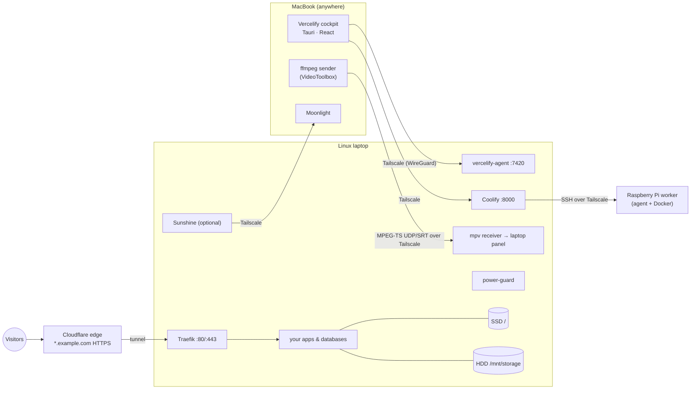

<p align="center">
  
</p>

<h1 align="center">Vercelify</h1>

<p align="center">
  <b>Your own Vercel on an old laptop. Free, forever.</b><br/>
  Put websites and apps online from a computer you already own, and control everything from your Mac.
</p>

<p align="center">
  <a href="https://github.com/shashank03-dev/vercelify-oss/actions/workflows/ci.yml"></a>
  <a href="LICENSE"></a>
  <a href="CONTRIBUTING.md"></a>
</p>

<p align="center">
  <b>New: "Why did my deploy fail?"</b> An open-weight model (Gemma 4 E2B) on your own hardware reads the failed build log and tells you the cause, the fix and how to check it.
</p>

<!-- Replace with a GIF of a real `vfy why` run (see the hackathon checklist). The image below is the cockpit in demo mode. -->
<p align="center">
  
  <br/><sub>The cockpit's <b>Explain with AI</b> button, shown in demo mode (<code>VITE_DEMO=1</code>, canned answer). With a real server the answer streams from Gemma 4 running in Ollama.</sub>
</p>

---

## Open-source AI: "Why did my deploy fail?"

A failed build on Linux often comes down to one line buried in 300: a case-sensitive
import, a missing env var, a lockfile out of sync. Vercelify hands that log to a small
open model and gets back three lines:

```text
**Cause:** the failing step and the root cause
**Fix:**   the exact change (file and line, setting, or command)
**Check:** one command to confirm the fix locally before pushing again
```

| | |
| --- | --- |
| **Model** | [Gemma 4 E2B](https://ai.google.dev/gemma) (`gemma4:e2b`): a small language model with ~2.3B effective parameters, open weights |
| **Model license** | Apache 2.0: <https://ai.google.dev/gemma/apache_2> |
| **Runtime** | [Ollama](https://github.com/ollama/ollama) (MIT), on your laptop or on the Vercelify server that built the app. No API bill, and the log never leaves your machines. |
| **Where** | `vfy why APP` and `vfy why --log FILE` in the CLI ([`cli/vfy`](cli/vfy)); **Explain with AI** on a failed build log in the cockpit ([`AppsView.tsx`](cockpit/src/views/AppsView.tsx)) |
| **Prompt** | One prompt shared by both ([`cockpit/src/lib/explain.ts`](cockpit/src/lib/explain.ts), and a test keeps it identical to the copy in `cli/vfy`). The log is trimmed to error lines with context plus the last 30 lines (≤ 5000 characters), and answers are capped at 400 tokens at temperature 0.2, so it stays quick on an old CPU. |
| **Model choice** | `gemma4:e2b` if installed, then any other Gemma 4, then any chat model. Override with `VFY_AI_MODEL`. |

Ollama's default `gemma4:e2b` download is about **7 GB**, and it needs about that much free
memory while it answers. On an 8 GB server, run it on your Mac instead (`vfy why --log`), or
use the Gemini API below. Details: [docs/AI.md](docs/AI.md).

### Try it in 2 minutes

You don't need a Vercelify server for either of these:

```bash
git clone https://github.com/shashank03-dev/vercelify-oss && cd vercelify-oss

# 1. The CLI, with Ollama on this machine (needs curl and jq)
ollama pull gemma4:e2b && ./cli/vfy why --log cli/examples/failed-build.log

# 2. The desktop UI in the browser, with demo data (canned answer, no model needed)
cd cockpit && npm ci && VITE_DEMO=1 npm run dev
# open http://localhost:1420 → Connect dell-e7450 (code K7QF-M2XD) → notes-api:
# "Deployments & logs" → the "Error" row → Build logs → Explain with AI
```

[`cli/examples/failed-build.log`](cli/examples/failed-build.log) is a Next.js build that works
on a Mac but fails on Linux: `app/page.tsx` imports `../components/Header`, and Linux file
names are case-sensitive.

### Gemma 4 via the Gemini API (optional)

No GPU and not enough RAM? The same prompt can go to Gemma 4 hosted on Google's Gemini API
(`why_gemini` in [`cli/vfy`](cli/vfy); model `gemma-4-26b-a4b-it`, or `gemma-4-31b-it` with
`VFY_GEMINI_MODEL`):

```bash
cp .env.example .env          # put your key from https://aistudio.google.com/apikey in it
set -a; . ./.env; set +a
./cli/vfy why --log cli/examples/failed-build.log --provider gemini
```

The key goes to curl on stdin, never on the command line, and `.env` is gitignored. This
path sends the trimmed log to Google, so it is opt-in; the default stays local.

Real output from `gemma-4-26b-a4b-it` via the Gemini API for the example log (23 Oct 2026):

```text
**Cause:** The `next build` step failed because `./app/page.tsx` attempts to import a component using a case-sensitive path that does not match the actual filename on the Linux filesystem.

**Fix:** Rename the import in `app/page.tsx` to match the exact casing of the file in the `components/` directory (e.g., change `../components/Header` to `../components/header` if the file is lowercase).

**Check:** `ls components/` to verify the exact casing of the file, then `npm run build` to test the import locally.

— gemma-4-26b-a4b-it via the Gemini API (Gemma 4, Apache 2.0)
```

### Use it from a coding agent

[`skills/vercelify`](skills/vercelify/SKILL.md) is an [Agent Skill](https://agentskills.io)
(MIT) that teaches Claude Code and other skill-aware coding agents to install Vercelify, drive
`vfy`, explain a failed deploy with `vfy why`, apply the fix and redeploy. Copy the folder into
your agent's skills directory (for Claude Code: `~/.claude/skills/vercelify`).

### Built with

| Part | Project | License |
| --- | --- | --- |
| AI model | Gemma 4 E2B (open weights) | [Apache 2.0](https://ai.google.dev/gemma/apache_2) |
| AI runtime | Ollama | MIT |
| PaaS engine | Coolify v4 (+ Traefik, Nixpacks) | Apache 2.0 (Traefik, Nixpacks: MIT) |
| Private network | Tailscale | BSD-3-Clause |
| Public HTTPS (optional) | Cloudflare Tunnel (`cloudflared`) | Apache 2.0 |
| Agent | Rust: tokio, axum, hyper, serde, clap | MIT / Apache 2.0 |
| Desktop app | Tauri v2, React 19, TypeScript, Tailwind CSS v4, Framer Motion, cmdk, Lucide | MIT / Apache 2.0 (Lucide: ISC) |
| Fonts | Geist, Geist Mono | SIL OFL 1.1 |
| CLI | bash, curl, jq | GPL (bash), curl license, MIT (jq) |

Vercelify itself is [MIT licensed](LICENSE).

### Hacktoberfest Hack Day Bengaluru 2026

Entered in **Track 1: Best Open-Source AI Project**, with **Track 2: Gemma 4 via the Gemini
API** verified against the real API (`--provider gemini`, sample output above). The pitch: deploying to your own old hardware should be as easy as
Vercel, with no cloud bill, and when a deploy breaks an open model on that same
hardware should tell you why.

---

## What is this?

You have an old laptop in a drawer. Vercelify turns it into your own personal
hosting service, like Vercel or Netlify, but free and on your own hardware.

- **Push your code to GitHub → your site updates by itself.**
- Every pull request gets its own **preview link**.
- A bad update? **One click to roll back** (or it rolls back by itself).
- **Databases** (Postgres, MySQL, Redis…) in one click.
- Your **own domain with HTTPS** (optional), even on a home internet connection.
- **Moving from Vercel?** Your `vercel.json` keeps working: redirects, rewrites, headers
  and cron jobs.
- A built-in **firewall**: block IPs, limit how fast bots can hit your site, or let only
  your own IPs in.
- Run **many apps at once**, and add more old laptops or Raspberry Pis when you need them.

You control it all from a friendly Mac app, from anywhere: home, office or café.

| Apps | Deployments, previews and rollback |
| --- | --- |
|  |  |
| **Storage** | **Health** |
|  |  |

---

## Before you start: what you need

| ✅ | What | Notes |
| --- | --- | --- |
| ☐ | **An old laptop or PC** (the "server") | Any 64-bit Intel/AMD machine. 4 GB RAM or more is best (8 GB is great), and at least 20 GB of free disk space. A Raspberry Pi 4/5 also works. |
| ☐ | **Ubuntu installed on it** | **Ubuntu 24.04 LTS** is recommended (Desktop or Server). Debian 12/13 and Ubuntu 22.04 work too. **This erases the old laptop**, so copy off anything you want to keep first. |
| ☐ | **Internet** on that laptop | A network cable is best; Wi-Fi is fine. |
| ☐ | **A Mac** | To run the control app. |
| ☐ | **A free Tailscale account** | Sign up at [tailscale.com](https://tailscale.com) with Google, Microsoft, GitHub or Apple. It connects your Mac to the laptop privately and safely. |
| ☐ | **About 30 minutes** | Most of it is waiting while things download. |

You do **not** need a domain name, a credit card, or to change any router settings.

> **Never installed Ubuntu before?** Follow Ubuntu's official step-by-step guide:
> [Install Ubuntu Desktop](https://ubuntu.com/tutorials/install-ubuntu-desktop). You'll need
> a USB stick (8 GB or bigger). When it asks, pick **"Erase disk and install Ubuntu"**.

---

## Install in 3 steps

### Step 1: Set up the old laptop (the server)

1. Turn on the laptop and log in to Ubuntu.
2. Open the **Terminal**: press <kbd>Ctrl</kbd> + <kbd>Alt</kbd> + <kbd>T</kbd>.
   (On Ubuntu Server you are already in one.)
3. Copy this line, paste it into the Terminal (<kbd>Ctrl</kbd> + <kbd>Shift</kbd> + <kbd>V</kbd>), and press <kbd>Enter</kbd>:

   ```bash
   sudo apt update && sudo apt install -y curl
   ```

   It asks for your password. **When you type it, nothing shows on screen. That is
   normal.** Just type it and press <kbd>Enter</kbd>.

4. Now copy and paste this line, then press <kbd>Enter</kbd>:

   ```bash
   curl -fsSL https://raw.githubusercontent.com/shashank03-dev/vercelify-oss/main/install.sh | sudo bash
   ```

5. **Answer a few simple questions.** If you're not sure, just press <kbd>Enter</kbd> to
   accept the default:

   | Question | What to answer |
   | --- | --- |
   | *Set up local AI models too?* | Press <kbd>Enter</kbd> (no). You can add it later. |
   | *E-mail for your Coolify login* | Your e-mail address. |
   | *Your domain* | Press <kbd>Enter</kbd> to skip. You can add one later. |
   | *Which disk should hold databases/volumes?* | Press <kbd>Enter</kbd> to keep everything on the main disk. |
   | *ALL DATA ON /dev/sdb WILL BE ERASED* (only if the laptop has a **second** disk) | Type the disk name it shows (e.g. `/dev/sdb`) only if that disk has nothing you need. **If in doubt, just press <kbd>Enter</kbd>**: nothing is erased and the installer stops. Then run the line below to use only the main disk. |

   > Skipped the disk question? Run this instead and everything goes on the main disk:
   >
   > ```bash
   > curl -fsSL https://raw.githubusercontent.com/shashank03-dev/vercelify-oss/main/install.sh | sudo bash -s -- --storage-device none
   > ```

6. **Approve the laptop on Tailscale.** The installer shows a link that starts with
   `https://login.tailscale.com/…`. Open it on your phone or Mac, sign in to your
   Tailscale account, and click **Connect**. (You have 10 minutes.)

7. **Wait.** The installer does the rest by itself. It takes about 10–20 minutes,
   depending on your internet speed. When it's done you will see:

   ```
   ✔ Vercelify is ready

     Coolify dashboard  http://laptop.tail1234.ts.net:8000
     Login              you@example.com / Vf-3a9c1e-B7D2F0!9
     ...
     Connect your Mac
       1. Install the app (and Tailscale):
            curl -fsSL https://raw.githubusercontent.com/shashank03-dev/vercelify-oss/main/install-mac.sh | bash
       2. Open Vercelify, pick laptop and type the code   K7QF-M2XD   (valid 1 hour)
   ```

   📸 **Take a photo of this screen** or write down the **Login** line and the
   **8-character code**. You'll need them in the next step.

8. Leave the laptop **plugged in**. You can close the lid. It keeps running.

### Step 2: Set up your Mac

1. Open the **Terminal** on your Mac: press <kbd>⌘</kbd> + <kbd>Space</kbd>, type
   `Terminal`, and press <kbd>Enter</kbd>.
2. Copy and paste this line, then press <kbd>Enter</kbd>:

   ```bash
   curl -fsSL https://raw.githubusercontent.com/shashank03-dev/vercelify-oss/main/install-mac.sh | bash
   ```

3. It installs **Tailscale**. When Tailscale opens (look for its icon in the menu bar at the
   top of the screen), **sign in with the same Tailscale account** you used in Step 1.
   (If Tailscale's website opens instead, download and install it from there, then sign in.)
4. It then installs the **Vercelify app** and opens it.

   > **If it says "no downloadable release yet"**, answer **y** to build the app on your
   > Mac. That needs three free tools. Install them once, then run the line from point 2
   > again:
   >
   > ```bash
   > xcode-select --install                                  # Apple's developer tools (a window pops up: click Install)
   > curl --proto '=https' -sSf https://sh.rustup.rs | sh -s -- -y   # Rust
   > ```
   >
   > and install **Node.js** (the "LTS" version) from [nodejs.org](https://nodejs.org).
   > Close and reopen the Terminal after installing them. The build takes 5–15 minutes,
   > one time only.

### Step 3: Connect them

1. In the Vercelify app, your laptop appears in the list. **Click it.**
2. **Type the 8-character code** from Step 1 (for example `K7QF-M2XD`).
3. Done! 🎉 You'll see your server's dashboard. A **Get started** card on the Apps page
   walks you through the next steps (first app, your own domain, phone alerts), each with
   its own button, and ticks them off as you go.

> **Code expired?** Codes last 1 hour. On the laptop, run `sudo vercelify pair` to get a
> new one.

---

## Put your first app online

1. In the Vercelify app, click **New app**.
2. Paste your GitHub repository's link (for example `https://github.com/you/my-site`) and
   pick the branch (usually `main`).
3. Click deploy. After a minute or two you get a link to your live app.

From now on, **every time you push to that branch, your app updates by itself.** Pull
requests get their own preview link automatically.

Most projects work with no setup at all: Next.js, React, Vue, Svelte, Astro, Node,
Python, Go, PHP, static sites, or anything with a `Dockerfile`.

### Finding your way around the app

| Where | What it's for |
| --- | --- |
| **Apps** | Your apps and databases. Click an app for its **Deployments, Previews, Logs, Environment, Domains, Auto-deploy** and **vercel.json** tabs. Anything stopped or failing shows in a red banner at the top. |
| **AI models** | Run open-source AI models on your machines and use them from your Mac. |
| **Servers · Health · Storage** | Every machine you've connected, how it's doing (CPU, memory, temperature, battery) and where app data lives. |
| **Second screen** | Use the laptop's screen as a monitor for your Mac. |
| **Settings** | Two tabs: the **server** (alerts, power, backups, who can connect) and **this computer** (connection, appearance). |

Hover any page in the sidebar to see what it does. Press <kbd>⌘</kbd> <kbd>K</kbd>
(<kbd>Ctrl</kbd> <kbd>K</kbd> elsewhere) to search apps, pages and actions, and
<kbd>⌘</kbd> <kbd>1</kbd>–<kbd>7</kbd> to jump between pages. The bell in the top-right
corner lists what needs your attention.

---

## Coming from Vercel?

Keep your `vercel.json`. Vercelify reads it from your repository every time your app
deploys and applies it on your server:

| In `vercel.json` | What happens |
| --- | --- |
| `redirects`, `rewrites`, `headers` | Work like on Vercel, including single-page apps (`/(.*)` → `/index.html`) and proxying to another site |
| `cleanUrls`, `trailingSlash` | `/about.html` becomes `/about`, slashes added or removed |
| `crons` | Your server calls the path on schedule, with the same `Authorization: Bearer $CRON_SECRET` header, so your cron code needs no change |
| `functions`, `regions`, `buildCommand`… | Not needed here: the app shows a short note saying why, and what to do instead |

Open your app in the Mac app and click the **vercel.json** tab to see what was applied,
anything that works differently, and your cron jobs with their last run (and a
**Run now** button).

**Add a firewall** with a second file, `vercelify.json`, next to `vercel.json`:

```json
{
  "firewall": {
    "blockIps": ["203.0.113.0/24"],
    "rules": [
      { "path": "/wp-admin/(.*)", "action": "deny" },
      { "path": "/api/(.*)", "action": "rate_limit", "requests": 60, "window": 60 }
    ]
  }
}
```

**Monorepo?** Set *Watch Paths* for the app in Coolify (for example `apps/web/**`). Pushes
that don't touch them aren't built, which saves your laptop a lot of work. A commit
message with `[skip deploy]` skips a build too.

Not on GitHub? Upload the files from the **vercel.json** tab, or from your project folder
with `vfy config push my-app`.

Everything Vercel does and what Vercelify offers for it, side by side:
[docs/VERCEL-PARITY.md](docs/VERCEL-PARITY.md). All the details:
[docs/PROJECT-CONFIG.md](docs/PROJECT-CONFIG.md).

---

## Optional extras

### Use your own domain with HTTPS

By default your apps are private: only your own devices (signed in to Tailscale) can
open them. To make them public at `https://myapp.yourdomain.com`:

1. Put your domain on [Cloudflare](https://cloudflare.com) (the free plan is fine).
2. Create an API token at [dash.cloudflare.com/profile/api-tokens](https://dash.cloudflare.com/profile/api-tokens)
   with these permissions: **Account › Cloudflare Tunnel › Edit**, **Zone › DNS › Edit**,
   **Zone › Zone › Read**.
3. On the laptop, run (with your own domain and token):

   ```bash
   sudo vercelify domain yourdomain.com --cloudflare-token YOUR_TOKEN
   ```

That's it: no router settings and no port forwarding, and it works on any home internet.
Full guide: [docs/COOLIFY.md](docs/COOLIFY.md).

### Add more laptops or a Raspberry Pi

Run the same Step 1 command on the new machine. In the app, open the server switcher and
click **Add a server…**, and it walks you through the rest. For a Raspberry Pi, install the
**64-bit** Raspberry Pi OS first. See [docs/SERVERS.md](docs/SERVERS.md) and
[docs/RASPBERRY-PI.md](docs/RASPBERRY-PI.md).

### Run AI models (Llama, Qwen, Gemma…)

Open the **AI models** page in the app and click install. It shows which models fit your
machine. See [docs/AI.md](docs/AI.md).

### Use it from the Terminal on your Mac (`vfy`)

The Mac installer also adds a small `vfy` command. It uses the servers you paired in the
app, so there's nothing to log in to:

```bash
vfy apps                     # your apps and whether they're up
vfy deploy my-app            # deploy now
vfy logs my-app              # what your app is printing
vfy rollback my-app 4b1d2e7  # put an earlier version back
vfy env pull my-app          # its settings into a .env file
vfy config check             # what this folder's vercel.json would do
vfy crons my-app             # its cron jobs and their last run
```

Run `vfy help` for everything.

### No Mac?

You can still use everything from the **Coolify dashboard** in any web browser. Install
Tailscale on your computer or phone, sign in to the same account, and open the dashboard
link from the end of Step 1.

---

## Everyday commands (on the laptop)

You rarely need these, but they're handy. Open the Terminal on the laptop and type:

| Command | What it does |
| --- | --- |
| `sudo vercelify status` | Shows if everything is running |
| `sudo vercelify doctor` | Finds problems and tells you how to fix them |
| `sudo vercelify pair` | Gives you a new code to connect the Mac app |
| `sudo vercelify update` | Updates Vercelify (undoes itself if something goes wrong) |
| `sudo vercelify backup setup` | Turns on nightly encrypted backups |

---

## Something went wrong?

| Problem | Fix |
| --- | --- |
| `curl: command not found` | Run `sudo apt update && sudo apt install -y curl` first (Step 1, point 3). |
| Typing my password shows nothing | That's normal. Type it and press <kbd>Enter</kbd>. |
| `… is not in the sudoers file` | Your user isn't an admin. The easiest fix is reinstalling Ubuntu, which makes the first user an admin automatically. |
| The Tailscale link expired | Run `sudo tailscale up` on the laptop and open the new link. |
| My laptop doesn't show up in the Mac app | Make sure Tailscale is **on** (menu-bar icon) and signed in to the **same account** on both machines. |
| The code doesn't work | It may have expired. Run `sudo vercelify pair` on the laptop for a fresh one. |
| macOS says the app "can't be opened" | Right-click the Vercelify app in **Applications** → **Open** → **Open**. Only needed the first time. |
| Anything else | Run `sudo vercelify doctor`. It checks about 15 things and says what to do. Also see [docs/TROUBLESHOOTING.md](docs/TROUBLESHOOTING.md). |

---

## Common questions

**Is it really free?** Yes. Everything is open source. There's nothing to pay for, unless
you choose to buy a domain name.

**Is 8 GB of RAM enough?** Yes, plenty for several apps and databases. Builds run one at
a time so the machine never gets overwhelmed.

**Can I close the laptop lid?** Yes. It keeps running with the lid closed.

**What if the battery runs low or it gets too hot?** Vercelify watches for that. If the
power is out and the battery gets low, it shuts down safely and starts your apps again
when power returns. If it gets too hot, it slows down busy apps first.

**Is it safe?** Yes. The control panel is only reachable through your private Tailscale
network, never from the public internet. Apps are only public if you choose to give them
a domain. Details below.

**Do I need a domain?** No. Without one your apps are private to your own devices. Add a
domain whenever you like.

**Will my Vercel project work?** Usually without changes. Your app runs as a normal
server instead of serverless functions, so there are no cold starts and no time limits,
and your `vercel.json` rules are applied for you. See [Coming from Vercel?](#coming-from-vercel).

---

## For developers

Everything below is technical detail. You don't need it to use Vercelify.

<details>
<summary><b>How it works</b></summary>

Vercelify combines proven open-source tools:

- **[Coolify v4](https://coolify.io)** is the hosting engine: GitHub App, Nixpacks builds,
  Traefik, Let's Encrypt, preview deployments and one-click databases.
- **Tailscale** links your Mac and the server privately from any network, with no open
  ports.
- **Cloudflare Tunnel** (optional) gives you public `https://*.yourdomain.com` without
  router configuration, even behind CGNAT.
- **The Vercelify agent** is a small Rust daemon on the host. It reports disks, power,
  temperatures and containers, moves volumes between SSD and HDD, deploys from Git
  without webhooks, turns each app's `vercel.json` into Traefik routes and runs its cron
  jobs, and runs the display receiver.
- **The Vercelify cockpit** is a Tauri v2 desktop app (React 19, Tailwind, Framer Motion,
  Geist) that ties it all together.
- **Host automation** is a one-line installer that handles storage tiers, kernel tuning,
  lid-close handling, the battery and thermal guard, the firewall and a `vercelify`
  admin CLI.



| Layer | Choice | Why this one |
| --- | --- | --- |
| PaaS | Coolify v4 | The most complete open-source Vercel/Heroku: GitHub App, PR previews, rollbacks, 280+ one-click services, multi-server, an API. |
| Builds | Nixpacks (+ Dockerfile/Compose) | Zero-config detection for every common framework. |
| Ingress | Traefik + Let's Encrypt, or Cloudflare Tunnel | Tunnel: no ports, CGNAT-proof, free wildcard TLS, DDoS protection. |
| Private network | Tailscale | WireGuard mesh with NAT traversal and MagicDNS. |
| Host agent | Rust (axum), one static binary | ~5 MB RSS, cross-compiles for the Pi, shares types with the app. |
| Desktop app | Tauri v2 + React 19 + Tailwind 4 + Framer Motion | Native, about 10 MB. |
| Display | ffmpeg (VideoToolbox) → mpv over UDP/SRT; Moonlight ↔ Sunshine | Hardware encoding on the Mac, DRM output on the laptop, ~30–60 ms on Tailscale. |

More: [docs/ARCHITECTURE.md](docs/ARCHITECTURE.md) ·
[docs/VERCEL-PARITY.md](docs/VERCEL-PARITY.md) (feature-by-feature comparison with Vercel,
including the honest differences).
</details>

<details>
<summary><b>All features</b></summary>

- **Deploy from a branch**: the agent checks the branch every 60 s with `git ls-remote`,
  so no webhook or open port is needed; private repositories work with a read-only token.
  [docs/AUTODEPLOY.md](docs/AUTODEPLOY.md)
- **PR previews**: each open GitHub pull request gets `pr-42-<app>.<domain>`, updated on
  every push and removed when it closes. Fork PRs are never built. With a token, deploys
  are reported as commit statuses and the preview URL is commented on the PR.
- **Automatic rollback**: if a new version comes up unhealthy, the previous one goes back
  live (instantly when its image is still on disk).
- **Your `vercel.json` works**: redirects, rewrites (single-page apps, proxying to another
  site), headers, `cleanUrls`, `trailingSlash` and `has`/`missing` conditions run in
  Coolify's Traefik, read from the repository at each deploy (previews from their own
  branch), or uploaded for other Git hosts. [docs/PROJECT-CONFIG.md](docs/PROJECT-CONFIG.md)
- **Cron jobs** from `vercel.json`, called with `CRON_SECRET` like on Vercel; last run,
  next run and **Run now** in the app; an alert after three failures in a row.
- **Firewall** (`vercelify.json`): blocked and trusted IPs (safe behind the Cloudflare
  tunnel), deny rules by path, user agent or method, and rate limits.
- **No needless builds**: pushes that change nothing in an app's watch paths, or say
  `[skip deploy]`, aren't built (Vercel's "Ignored Build Step").
- **Hardware profiles**: Raspberry Pi 4/5 get their own temperature limits, zram, working
  memory limits, under-voltage checks, a hang watchdog and clock sync.
  [docs/RASPBERRY-PI.md](docs/RASPBERRY-PI.md)
- **Never out of memory**: containers run in a memory-capped slice; the OOM killer takes
  builds first, databases last.
- **Power & thermal guard**: on battery ≤ 15% it stops apps, then Coolify, and powers off,
  restoring exactly those containers on the next boot. At ≥ 92 °C it pauses non-core
  containers (resumes below 80 °C); sustained ≥ 98 °C means graceful shutdown. Optional
  80% charge cap.
- **Alerts** to ntfy, Discord, Slack or any webhook: disk filling or failing (SMART),
  missing HDD, out of memory, power, Tailscale key expiry, failed deploys or backups,
  rollbacks. It repairs what it safely can and says so.
- **Backups**: nightly, encrypted, to the HDD, another server and/or S3, including
  Coolify's secrets and consistent database dumps. [docs/BACKUPS.md](docs/BACKUPS.md)
- **Safe updates**: versioned releases that roll themselves back on failure. Coolify is
  pinned to the tested release; `vercelify coolify upgrade` upgrades it on purpose.
- **Sleeping apps**: idle apps stop to free memory; the next visitor waits a second or two.
- **Security updates**: a nightly window reboots only when needed, never during a build,
  backup or update, or on battery.
- **Storage tiers**: move any database or volume between SSD and HDD in one click, with
  data, owners and permissions preserved. The HDD mounts with `nofail` and an immutable
  empty mount point, so a missing disk fails loudly instead of filling the SSD.
- **Many servers, one app**: switch with the sidebar or ⌘K; update them all in one click;
  workers join a main server's pool so one Coolify deploys to all of them.
  [docs/SERVERS.md](docs/SERVERS.md)
- **Local AI** with Ollama, tuned for 8 GB: one model in memory, unloaded when idle.
  [docs/AI.md](docs/AI.md)
- **Second screen**: use the laptop's screen as a second Mac monitor, or view the Linux
  desktop on the Mac with Moonlight. [docs/DISPLAY.md](docs/DISPLAY.md)
- **`vfy` on your Mac**: `vfy apps`, `vfy deploy blog`, `vfy logs blog`,
  `vfy rollback blog 4b1d2e7`, `vfy env pull blog`, `vfy config check|push|sync blog`,
  `vfy crons blog [run PATH]`, `vfy sleep blog`, `vfy status`, `-s <server>`.
</details>

<details>
<summary><b>All <code>vercelify</code> commands</b></summary>

| Command | What it does |
| --- | --- |
| `sudo vercelify status` | One-screen overview |
| `sudo vercelify doctor` | Checks about 15 things and tells you how to fix each failure |
| `sudo vercelify pair [--refresh]` | One-time 8-character code for the Mac app, and the full pairing code |
| `sudo vercelify llm [install\|pull M\|rm M\|chat M "…"\|stop]` | Local AI models (Ollama) |
| `sudo vercelify autodeploy [list\|add APP REPO [BRANCH]\|rm APP\|check APP]` | Deploy an app on every push to a branch |
| `sudo vercelify domain [example.com] [--cloudflare-token T]` | Switches domain mode (no argument = private sslip.io) |
| `sudo vercelify add-worker pi@raspberrypi` | Installs a worker over SSH and registers it in Coolify |
| `sudo vercelify logs agent\|guard\|coolify\|tunnel` | Follows a component's logs |
| `sudo vercelify backup [setup\|run\|list\|restore]` | Encrypted nightly backups; restore files or a whole server |
| `sudo vercelify tokens [revoke ID]` | Devices paired with this server; revoke a lost one |
| `sudo vercelify registry [install\|trust H:P\|multiarch]` | Image registry on the tailnet: build on the strong machine, pull on the Pi |
| `sudo vercelify routes sync` | Public routes for apps on pooled servers (runs every 5 min) |
| `sudo vercelify coolify [check\|upgrade [VERSION]]` | Check or upgrade Coolify (default: the tested version) |
| `sudo vercelify sleep [on APP [MIN]\|off APP]` | Stop idle apps to free memory; the next visit wakes them |
| `sudo vercelify maintenance [on [HH:MM]\|off]` | Nightly reboot window for security updates |
| `sudo vercelify update [--edge\|--ref TAG]` / `rollback` / `uninstall` | Update (rolls back by itself on failure) / previous version / remove Vercelify's parts (keeps Coolify and data) |
</details>

<details>
<summary><b>All installer options (unattended installs, workers, storage)</b></summary>

```
sudo ./host/setup-host.sh --help

Role
  --worker                 Worker node (e.g. Raspberry Pi): Docker + Tailscale + agent only
  --coolify-pubkey KEY     (worker) Coolify's SSH public key to authorise for root
Network & domain
  --hostname NAME          Machine name on your tailnet
  --tailscale-authkey KEY  Join Tailscale without opening a login link
  --domain DOMAIN          Your domain: apps get *.DOMAIN
  --cloudflare-token TOK   Cloudflare API token: creates a tunnel + DNS for you
  --force-dns              Replace existing DNS records for *.DOMAIN and DOMAIN
Storage
  --storage-device DEV     Disk for databases/volumes (default: auto-detect; 'none')
  --format-storage         Allow formatting that disk as ext4 (ERASES IT)
Coolify
  --admin-email EMAIL / --admin-password PASS
Features
  --ai [MODEL]   also install Ollama (local AI) and download MODEL
  --no-firewall  --no-power-guard  --no-display
General
  -y, --yes  --dry-run  -h, --help
```

Fully unattended:

```bash
curl -fsSL https://raw.githubusercontent.com/shashank03-dev/vercelify-oss/main/install.sh | sudo bash -s -- \
  -y --hostname laptop --tailscale-authkey tskey-auth-… \
  --domain example.com --cloudflare-token … --storage-device /dev/sdb
```

Mac installer options: `--with-display` (ffmpeg + Moonlight), `--from-source`,
`--no-tailscale`, `--dest DIR`, `-y`.

| Domain mode | Command | Apps are at | Needs |
| --- | --- | --- | --- |
| Private | *(default)* | `http://<app>.<tailscale-ip>.sslip.io` (tailnet only) | nothing |
| Cloudflare Tunnel | `vercelify domain example.com --cloudflare-token T` | `https://<app>.example.com` | domain on Cloudflare (free plan) |
| Direct | `vercelify domain example.com` | `https://<app>.example.com` | public IP, ports 80/443 forwarded, A records |
</details>

<details>
<summary><b>Security model</b></summary>

- The control plane is private. The agent listens only on the Tailscale IP and
  localhost, and every call except `/v1/health` needs a 256-bit bearer token (compared in
  constant time). Each paired device gets its own hashed, revocable token; every change
  made through the API is written to an audit log.
- Containers can't reach the rest of your tailnet, so app code (a PR preview, a
  compromised dependency) is not a way into your network. Only SSH, Coolify and the
  registry are allowed across servers (`/etc/vercelify/firewall.conf`). DOCKER-USER rules
  block the Coolify dashboard and websockets (8000/6001/6002/8080) on every interface
  except `tailscale0` and Docker bridges.
- Apps are public only on purpose: through Cloudflare (your home IP is never published)
  or through ports you forward yourself.
- `vercel.json` can't open private things to the internet: a rewrite to this machine or a
  private network (Ollama, the Coolify dashboard, a database) is refused. The firewall
  trusts Cloudflare's visitor-IP header only on connections from the tunnel on this
  machine, so it can't be faked from outside.
- Secrets live in `/etc/vercelify` (0600/0750, root only) on the host and in the app's
  config directory (0600) on the Mac. The pairing code contains secrets: treat it like a
  password.
- The embedded Coolify window has no access to the cockpit's IPC.
- The agent runs as root under systemd hardening, with an allowlist of controllable units
  and strict validation of container IDs, volume names and stream URLs.
- Unattended security upgrades are enabled; SSH allows keys only for root.
</details>

<details>
<summary><b>Build from source and run the tests</b></summary>

```bash
# prerequisites: Rust (rustup), Node 20+, and on macOS Xcode Command Line Tools
git clone https://github.com/shashank03-dev/vercelify-oss && cd vercelify-oss/cockpit
npm ci
npm run tauri build        # → target/release/bundle/{dmg,macos}/Vercelify*
VITE_DEMO=1 npm run dev    # the UI with mock data, in a browser
```

| Suite | Command |
| --- | --- |
| Rust unit, fixture and agent e2e tests | `cargo test --workspace --all-features` |
| Host scripts (bats) | `bats host/tests` |
| Frontend unit (vitest) | `cd cockpit && npm test` |
| Demo UI flows (Playwright) | `cd cockpit && npm run e2e:demo` |
| Coolify contract (real Coolify in Docker) | `sudo host/tests/contract/coolify.sh` |
| Project rules on a real Traefik (vercel.json, firewall, crons) | `sudo host/tests/contract/routing.sh` |
| Installer integration (privileged Debian container) | `sudo host/tests/integration/run.sh` |
| Live, desktop (real Tauri binary) and arm64 (QEMU) suites | see [docs/DEVELOPMENT.md](docs/DEVELOPMENT.md) |

CI (`.github/workflows/ci.yml`) runs the Rust, bats, ShellCheck, typecheck, vitest and
demo UI suites plus arm64 under QEMU; `integration.yml` runs the Coolify contract, the
project rules on a real Traefik (3.7, and 3.4 as an early warning) and the full installer
test. Release builds produce the macOS app (universal) and Linux packages.

```
install.sh          one-line server bootstrap (downloads + runs host/setup-host.sh)
install-mac.sh      one-line Mac setup: Tailscale + the cockpit app
host/               installer, power-guard, firewall, vercelify CLI, systemd units, tests
crates/             shared Rust types (exported to TypeScript) and host probes
agent/              vercelify-agent (axum)
cockpit/            Tauri v2 app (src-tauri/ = Rust, src/ = React UI)
cli/vfy             Mac/Linux command-line tool
docs/               guides: Coolify, architecture, vercel.json, Vercel parity, display, troubleshooting, development
```
</details>

## Contributing

Vercelify is open source and contributions are welcome: bug reports, docs, fixes and
features. Start with [CONTRIBUTING.md](CONTRIBUTING.md), and please follow the
[Code of Conduct](CODE_OF_CONDUCT.md). Report security issues privately as described in
[SECURITY.md](SECURITY.md).

## License

[MIT](LICENSE). Coolify, Tailscale, Cloudflare, Moonlight, Sunshine and mpv are separate projects
under their own licenses.
