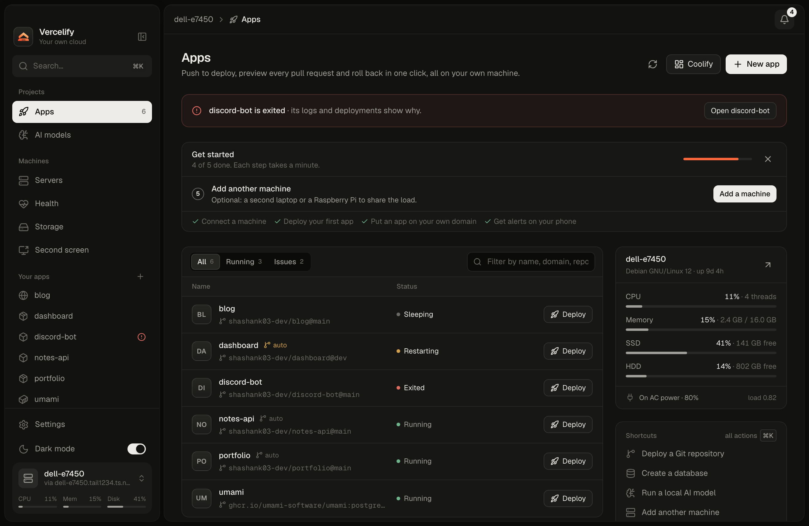
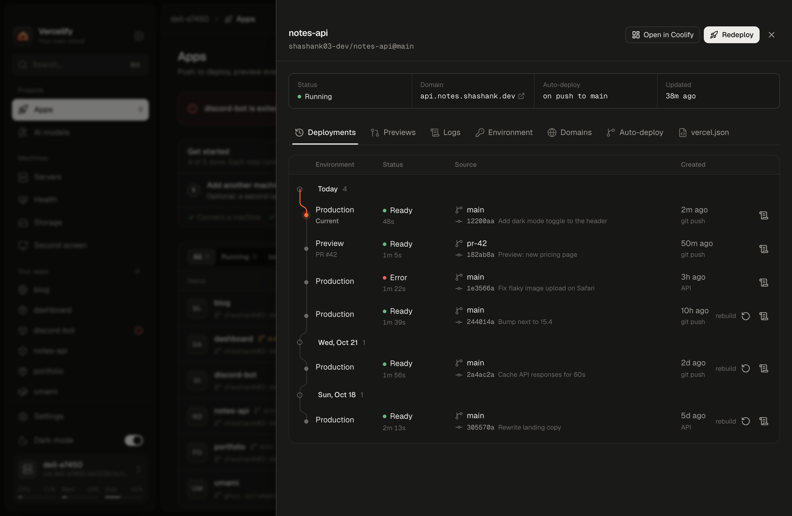
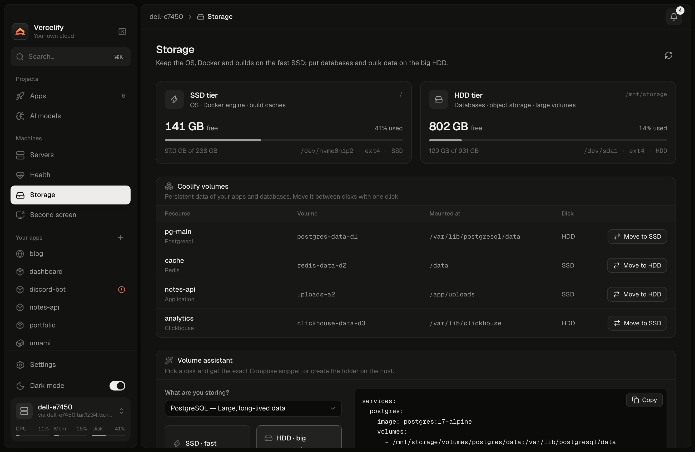
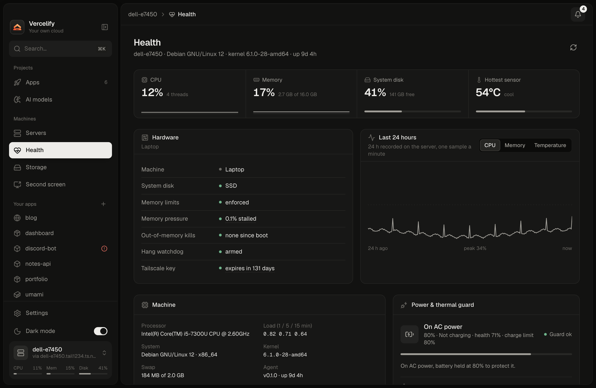
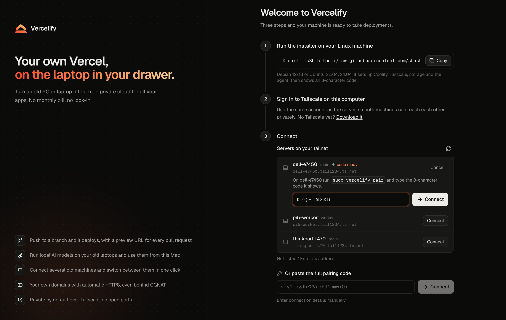
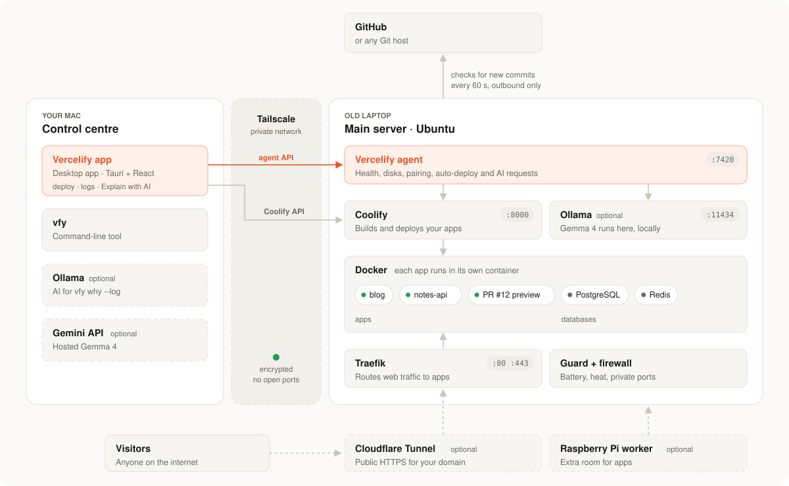

<p align="center">
  
</p>

<h1 align="center">Vercelify</h1>

<p align="center">
  <b>Turn the old laptop in your drawer into your own Vercel.</b><br/>
  When a deploy breaks, a free, open AI model reads the log and tells you why.
</p>

<p align="center">
  <a href="https://github.com/shashank03-dev/vercelify-oss/actions/workflows/ci.yml"></a>
  <a href="LICENSE"></a>
  <a href="skills/vercelify/SKILL.md"></a>
  <a href="CONTRIBUTING.md"></a>
</p>

<p align="center">
  <a href="#try-it-in-five-minutes">Try it in 5 minutes</a> ·
  <a href="#set-up-your-own-server">Set up your server</a> ·
  <a href="#how-the-ai-works">How the AI works</a> ·
  <a href="#hacktoberfest-hack-day-2026">Hack Day submission</a>
</p>

---

Hosting a small website or API usually means a monthly bill, or an afternoon lost to
server setup. Most students already own something good enough to host it: an old laptop
or PC that nobody uses any more.

**Vercelify turns that machine into a personal hosting platform.** You push code to
GitHub and your app goes live, just like on Vercel or Netlify, except it runs on hardware
you own and costs nothing per month. Everything is controlled from a desktop app on your
Mac.

When a build fails, Vercelify doesn't leave you scrolling through 300 lines of log. An
open AI model (Google's **Gemma 4**, running on your own computer through **Ollama**)
reads the important part and answers in three short lines:

<p align="center">
  
  <br/><sub>A real Gemma 4 answer for the <a href="cli/examples/failed-build.log">example failed build</a>, recorded through the Gemini API on 23 Oct 2026. Leave out <code>--provider gemini</code> to run the same model on your own computer.</sub>
</p>

## What you get

- **Push to deploy.** Connect a GitHub repository. Every push to your branch builds and
  publishes a new version automatically.
- **Preview links for pull requests.** Each pull request gets its own temporary copy of
  the site, so you can check a change before merging it.
- **One-click rollback.** If a new version breaks something, go back to the last
  working one.
- **"Why did my deploy fail?"** A local AI model explains failed builds in plain English,
  with a suggested fix and a command to confirm it.
- **Databases.** Run PostgreSQL, MySQL, MongoDB or Redis next to your apps.
- **Your own domain with HTTPS.** Optional. Works even if your home internet doesn't give
  you a public IP address.
- **Private by default.** Nothing is exposed to the internet until you choose to publish
  an app.
- **Looks after old hardware.** Watches temperature, battery, disk space and memory, and
  warns you before something fails.

## See it in action

<p align="center">
  
  <br/><sub>Open a failed deployment, click <b>Explain with AI</b>, and get the cause, the fix and a way to check it.</sub>
</p>

| Your apps | Every deployment, with logs |
| --- | --- |
|  |  |
| **Storage and disks** | **Server health** |
|  |  |

## Try it in five minutes

You don't need a spare server for any of these. Pick one.

### Option A: Run the AI on your own computer (free, offline)

This runs the open Gemma 4 model on your laptop and asks it to explain a real failed
build log that ships with the repository.

**You need:** macOS or Linux, [Git](https://git-scm.com/downloads), `jq`
(`brew install jq` or `sudo apt install jq`), and [Ollama](https://ollama.com/download),
a free app that runs AI models locally. Open Ollama once after installing it so it's
running in the background.

```bash
# 1. Download this project
git clone https://github.com/shashank03-dev/vercelify-oss.git
cd vercelify-oss

# 2. Download the Gemma 4 model (one time, several GB)
ollama pull gemma4:e2b

# 3. Ask it why the example build failed
./cli/vfy why --log cli/examples/failed-build.log
```

The first answer takes a little longer while the model loads. You'll see three lines:
**Cause**, **Fix** and **Check**. Nothing leaves your computer.

> **Low on memory?** Gemma 4 E2B needs roughly 7 GB of disk space and a similar amount of
> free memory while it answers. On a smaller machine, pull any smaller chat model and tell
> `vfy` to use it, for example `VFY_AI_MODEL=gemma3:1b ./cli/vfy why --log cli/examples/failed-build.log`.

### Option B: Use Gemma 4 through Google's Gemini API (no download)

Same feature, but the model runs on Google's servers instead of your laptop. This is how
the answer at the top of this page was recorded. The log you send goes to Google, so
check it for passwords or keys first.

1. Get a free API key at [aistudio.google.com/apikey](https://aistudio.google.com/apikey).
2. From the `vercelify-oss` folder, run:

```bash
cp .env.example .env
# Open .env in any text editor and paste your key after GEMINI_API_KEY=
set -a; . ./.env; set +a
./cli/vfy why --log cli/examples/failed-build.log --provider gemini
```

The default model is `gemma-4-26b-a4b-it`. Choose another with `VFY_GEMINI_MODEL`. The
`.env` file is ignored by Git, so your key is never committed.

### Option C: Click around the app with sample data

**You need:** [Node.js 22](https://nodejs.org/) and Git.

```bash
cd vercelify-oss/cockpit
npm ci
VITE_DEMO=1 npm run dev
```

Open [localhost:1420](http://localhost:1420) in your browser and:

1. Pick the server called **dell-e7450** and type the pairing code `K7QF-M2XD`.
2. Open the **notes-api** app → **Deployments & logs**.
3. Click the deployment marked **Error** → **Build logs** → **Explain with AI**.

Demo mode uses made-up servers and a pre-written AI answer, so you can see the whole
flow without any setup. For a real model answer, use Option A or B.

## Set up your own server

This is the full setup: an old laptop becomes your server, and your Mac becomes the
remote control. Plan for **30 to 45 minutes**, most of it waiting for downloads.

### What you need

| | Requirement | Notes |
| --- | --- | --- |
| 🖥️ | **A spare laptop or PC** (64-bit, Intel or AMD) | 4 GB of memory works; 8 GB is comfortable. 20 GB of free disk space or more. A 7th-gen Core i5 with 8 GB is plenty. A Raspberry Pi 4 or 5 can join later as an extra worker ([guide](docs/RASPBERRY-PI.md)). |
| 🐧 | **Ubuntu 24.04 LTS** on that machine | Debian 12/13 and Ubuntu 22.04 also work. If it still runs Windows, follow Ubuntu's [install guide](https://ubuntu.com/tutorials/install-ubuntu-desktop) to replace it. **Back up anything you want to keep first.** |
| 💻 | **A Mac** | This is where the Vercelify desktop app runs. You control the server from here. |
| 🔐 | **A free [Tailscale](https://tailscale.com) account** | Tailscale creates a private, encrypted link between your Mac and the server, wherever they are. You sign up with Google, GitHub or Microsoft. |
| 🌐 | **Internet on both machines** | A network cable on the server is more reliable than Wi-Fi, but either works. |

### Step 1: Install Vercelify on the old laptop

On the old laptop, open **Terminal** (press <kbd>Ctrl</kbd>+<kbd>Alt</kbd>+<kbd>T</kbd> on
Ubuntu) and paste these two commands:

```bash
sudo apt update && sudo apt install -y curl
```

```bash
curl -fsSL https://raw.githubusercontent.com/shashank03-dev/vercelify-oss/main/install.sh | sudo bash -s -- --storage-device none
```

Type your Ubuntu password when asked (it won't show as you type; that's normal). Here's
what happens next:

<p align="center">
  
  <br/><sub>The server installer from start to finish (shortened; the real run takes 10–20 minutes).</sub>
</p>

**1. It checks the machine.** Operating system, memory, disk space and internet. If
something is missing, it tells you what to fix.

**2. It asks three questions.** Press <kbd>Enter</kbd> to accept the default for any of them.

| Question | What to answer |
| --- | --- |
| *Set up local AI models too?* | `n` for now. You can add AI later in one command (see [Step 5](#step-5-optional-turn-on-ai-on-the-server)). |
| *E-mail for your Coolify login* | Any email address you own. It's only used to log in to the dashboard on your server. |
| *Your domain* | Leave it blank. Your apps will still work privately; you can add a domain any time. |

**3. It installs everything.** You'll see one line per step. The important ones:

- **Docker** runs each of your apps in its own sealed box, so they can't interfere with
  each other.
- **Tailscale** prints a link like `https://login.tailscale.com/a/…`. **Open that link on
  any device and sign in** to add the laptop to your private network. The installer waits
  for you.
- **Coolify** is the open-source engine that builds and runs your apps. Vercelify sets it
  up and controls it for you.
- **Vercelify agent** is a small program that lets the Mac app see and manage the server.
- **Laptop server mode** keeps the laptop running with the lid closed, and the
  **power & thermal guard** protects the battery and slows things down if it gets too hot.

**4. It prints a summary.** Look for the line with your **8-character pairing code**
(like `K7QF-M2XD`). Keep this window open; you'll need the code in Step 3. The code is
valid for one hour. If it expires, run `sudo vercelify pair` to get a new one.

> **Why `--storage-device none`?** It keeps everything on the laptop's main disk. If the
> machine has a second disk you'd like to use for databases and backups, pass
> `--storage-device /dev/sdb` (your disk's name) instead. Vercelify only erases a disk
> if you also add `--format-storage`, so it never wipes anything by surprise.

From now on, leave the laptop plugged in and connected. You can close the lid.

### Step 2: Install the app on your Mac

Open **Terminal** on your Mac (press <kbd>⌘</kbd>+<kbd>Space</kbd>, type *Terminal*) and run:

```bash
curl -fsSL https://raw.githubusercontent.com/shashank03-dev/vercelify-oss/main/install-mac.sh | bash
```

<p align="center">
  
  <br/><sub>The Mac installer (the build step is shortened).</sub>
</p>

This installs three things:

1. **Tailscale** for the Mac. When it opens in the menu bar, **sign in with the same
   account** you used on the laptop. That's how the two machines find each other.
2. **The Vercelify app**, into your Applications folder. While there's no ready-made
   download yet, the installer offers to build the app on your Mac (answer `y`). The build
   takes 5–15 minutes and needs three free developer tools. If one is missing, the
   installer stops and tells you exactly what to run:
   - Xcode Command Line Tools: `xcode-select --install`
   - Node.js: `brew install node` (or from [nodejs.org](https://nodejs.org/))
   - Rust: `curl https://sh.rustup.rs -sSf | sh`
3. **`vfy`**, a command-line tool for deploying and reading logs from the terminal.

### Step 3: Connect the app to your server

Vercelify opens automatically when the installer finishes.

<p align="center">
  
</p>

1. Under **Servers on your tailnet**, find your laptop by name.
2. Type the **8-character code** from the end of Step 1.
3. Click **Connect**.

Don't see your laptop? Check that Tailscale on the Mac is signed in to the **same
account**, then click the refresh icon.

### Step 4: Deploy your first app

1. In the app, click **New app**.
2. Paste the URL of a GitHub repository, for example a Next.js, Vite, Express or
   Python project, or anything with a `Dockerfile`.
3. Choose the branch to deploy (usually `main`).
4. Add any environment variables your app needs (API keys, database URLs).
5. Click **Deploy** and watch the build log live.

When it finishes, you get a link to your running app. It works on any device signed in
to your Tailscale account, including your phone. Private repositories need GitHub access
set up first; see the [auto-deploy guide](docs/AUTODEPLOY.md), which also covers automatic
deploys on every push and preview links for pull requests.

**If the build fails,** open it, click **Build logs**, then **Explain with AI**.

### Step 5 (optional): Turn on AI on the server

So that **Explain with AI** works from the app, install Ollama and a model on the server.
Run this on the laptop:

```bash
sudo vercelify ai install
sudo vercelify ai pull gemma4:e2b
```

On a machine with 8 GB that's also running apps, Gemma 4 E2B may not have enough free
memory. Use a smaller model (`sudo vercelify ai pull gemma3:1b`) or keep using
`vfy why --log` on your Mac. More in the [AI guide](docs/AI.md).

### Step 6 (optional): Put an app on the public internet

Apps start private. To give one a public address like `https://blog.yourdomain.com`, you
need a domain name. The easiest route is to manage it with a free Cloudflare account:
Vercelify then creates a secure tunnel, so you don't have to change any router settings,
and it works even when your internet provider doesn't give you a public IP address.

1. Add your domain to Cloudflare.
2. Create an API token at [dash.cloudflare.com/profile/api-tokens](https://dash.cloudflare.com/profile/api-tokens)
   with these permissions: *Account › Cloudflare Tunnel › Edit*, *Zone › DNS › Edit* and
   *Zone › Zone › Read*.
3. On the server, run:

```bash
sudo vercelify domain yourdomain.com --cloudflare-token YOUR_TOKEN
```

New apps then get addresses like `https://myapp.yourdomain.com`. Details, and the option
without Cloudflare, are in the [domains guide](docs/COOLIFY.md).

### If something goes wrong

| Problem | What to do |
| --- | --- |
| The installer stopped with an error | Fix what it mentions and **run the same command again**. Finished steps are skipped. |
| Not sure what's wrong with the server | `sudo vercelify doctor` checks everything and suggests fixes. |
| Pairing code expired | `sudo vercelify pair` prints a new one. |
| The Mac app can't see the server | Make sure both machines are signed in to the same Tailscale account and the laptop is awake and online. |
| Need the full installer log | It's in `/var/log/vercelify-setup.log` on the server. |

More answers are in [troubleshooting](docs/TROUBLESHOOTING.md).

## How the AI works

The AI feature does one useful job: **explain why a deployment failed.**

```text
failed build log ──▶ keep only the useful lines ──▶ Gemma 4 (local, via Ollama) ──▶ Cause / Fix / Check
     (300+ lines)         (errors + context,              same prompt in the              (under 120 words)
                           last 30 lines, ≤ 5,000 chars)   app and the CLI)
```

1. **It picks the right lines.** Build logs are long and mostly noise. Vercelify keeps the
   error lines with a little context around them, plus the last 30 lines, up to 5,000
   characters. That keeps answers fast even on an old CPU.
2. **It asks a small open model.** The trimmed log goes to **Gemma 4 E2B** running in
   Ollama, on your Mac or on your server. Nothing goes to a paid service.
3. **It answers in a fixed format.** **Cause** (what went wrong), **Fix** (what to change)
   and **Check** (a command to confirm the fix works), in under 120 words. Low temperature
   (0.2) keeps answers focused.
4. **You stay in control.** The AI only suggests. It never edits your code or redeploys
   on its own. It only sees the log, not your repository, so double-check its advice.

| Part | Where it lives |
| --- | --- |
| Prompt and log trimming | [`cockpit/src/lib/explain.ts`](cockpit/src/lib/explain.ts), with [tests](cockpit/src/lib/explain.test.ts) that keep the app and CLI prompts identical |
| Command line | `vfy why APP` (a deployment on your server) and `vfy why --log FILE` (any log file), in [`cli/vfy`](cli/vfy) |
| Desktop app | **Explain with AI** on a failed build, in [`AppsView.tsx`](cockpit/src/views/AppsView.tsx), streamed from the server's Ollama |
| Model choice | Uses `gemma4:e2b` if installed, then any other Gemma 4, then any installed chat model. Override with `VFY_AI_MODEL`. |
| Hosted option | `--provider gemini` calls Gemma 4 through the Gemini API (`why_gemini` in [`cli/vfy`](cli/vfy)) |

Vercelify uses existing open models; it doesn't train its own. The work here is
everything around the model: picking the right part of the log, the shared prompt, and
putting the answer exactly where you need it. Full details in the [AI guide](docs/AI.md).

### Agent Skill for coding assistants

[`skills/vercelify`](skills/vercelify/SKILL.md) is an
[Agent Skill](https://agentskills.io/specification) that teaches AI coding assistants
(Claude Code, OpenCode and other skill-aware agents) how to install Vercelify, deploy
with `vfy`, read a failed build with `vfy why`, fix it and redeploy. It follows the open
Agent Skills format: a `SKILL.md` with name, description, license and compatibility,
plus reference files for the CLI and the agent API.

To use it, copy the folder into your agent's skills directory, for example:

```bash
cp -r skills/vercelify ~/.claude/skills/vercelify
```

## Hacktoberfest Hack Day 2026

Built for **Hacktoberfest Hack Day Bengaluru** (23 October 2026, Atria Institute of
Technology, hosted by the AWS Student Builder Group at Atria Institute of Technology).

**Submitted to Track 1: Best Open-Source AI Project.** It also uses Gemma 4 through the
Gemini API, which is relevant to Track 2: Best Use of Gemma 4.

| Track requirement | How Vercelify meets it |
| --- | --- |
| Open-source or open-weight AI is an important part of the project | Gemma 4 (open weights, Apache 2.0) running in Ollama (MIT) explains every failed deployment, in both the app and the CLI. |
| Public GitHub repository with an open-source license | This repository, under the [MIT License](LICENSE). |
| Agent skills follow the Agent Skill open standard | [`skills/vercelify/SKILL.md`](skills/vercelify/SKILL.md) follows the [specification](https://agentskills.io/specification). |
| A demo you can actually run | [Option A](#option-a-run-the-ai-on-your-own-computer-free-offline) runs a real model on the included log in three commands; [Option C](#option-c-click-around-the-app-with-sample-data) shows the full app. |

**Judging walkthrough (about 3 minutes):**

1. Open [`cli/examples/failed-build.log`](cli/examples/failed-build.log). The real error
   is buried near line 25.
2. Run `./cli/vfy why --log cli/examples/failed-build.log` and compare the answer with
   the log.
3. Show the prompt and log trimming in [`explain.ts`](cockpit/src/lib/explain.ts).
4. Open the app in demo mode and click **Explain with AI** on the failed deployment
   (the demo answer is pre-written; step 2 is the live one).
5. Show the [Agent Skill](skills/vercelify/SKILL.md).

## How it's built

<p align="center">
  <picture>
    <source media="(prefers-color-scheme: dark)" srcset="docs/diagrams/architecture-dark.svg" />
    
  </picture>
</p>

How the pieces work together:

1. **You click Deploy** in the app (or push to GitHub). The app talks to the server over
   **Tailscale**, a private encrypted network, so the server never needs an open port.
2. **The Vercelify agent** on the server is the app's point of contact. It reports health
   and disks, handles pairing, checks GitHub for new commits every minute, and forwards
   AI requests.
3. **Coolify** builds your code and starts it in its own **Docker** container, next to
   any databases it needs.
4. **Traefik** sends each web request to the right app. To open an app to the internet,
   an optional **Cloudflare Tunnel** carries visitors in without exposing your home network.
5. **Ollama** runs Gemma 4 on the server so **Explain with AI** works without any paid
   service.

- **Desktop app:** Tauri v2, React 19, TypeScript and Tailwind ([`cockpit/`](cockpit))
- **Server agent:** a ~3 MB Rust program ([`agent/`](agent), [`crates/vercelify-core`](crates/vercelify-core))
- **Installer and admin tool:** Bash, tested with bats and ShellCheck ([`host/`](host))
- **Command line:** [`cli/vfy`](cli/vfy), Bash, works on the bash that ships with macOS

Vercelify doesn't reinvent hosting: it builds on [Coolify](https://coolify.io), a proven
open-source platform, and adds the desktop app, hardware care, `vercel.json` support and
the AI workflow. The connection between your Mac and the server stays inside your private
Tailscale network and uses revocable access tokens. More in
[architecture](docs/ARCHITECTURE.md) and [security](SECURITY.md).

**Coming from Vercel?** Vercelify reads the common parts of `vercel.json` (redirects,
rewrites, headers and cron jobs). See [what's supported](docs/VERCEL-PARITY.md) and the
[configuration guide](docs/PROJECT-CONFIG.md).

## What it costs

There's no subscription and no paid AI API. You pay only for what you'd pay anyway:
electricity for the laptop (old laptops usually draw little power when idle), your internet
connection, and a domain name if you want a public address. Tailscale and Cloudflare
both have free plans that cover personal use.

## Contributing

Bug reports, docs fixes and code are all welcome. Start with
[CONTRIBUTING.md](CONTRIBUTING.md) for setup and conventions, and open an issue first for
bigger changes. Please follow the [Code of Conduct](CODE_OF_CONDUCT.md) and report
security issues privately as described in [SECURITY.md](SECURITY.md).

<details>
<summary><b>Build from source and run the tests</b></summary>

Prerequisites: Rust (stable), Node.js 22, `jq`, `shellcheck` and `bats`. The Rust
workspace also needs the [Tauri prerequisites](https://v2.tauri.app/start/prerequisites/)
and a `cockpit/dist` folder; see [DEVELOPMENT.md](docs/DEVELOPMENT.md).

```bash
cd cockpit && npm ci && npm run tauri build    # build the Mac app
```

| Check | Command (from the repository root) |
| --- | --- |
| Rust tests | `cargo test --workspace --all-features` |
| Installer and CLI tests | `bats host/tests` |
| App type check | `cd cockpit && npm run typecheck` |
| App unit tests | `cd cockpit && npm test` |
| App end-to-end tests | `cd cockpit && npm run e2e:demo` |
| Against a real Coolify | `sudo host/tests/contract/coolify.sh` (needs Docker) |

The animated terminal demos in this README are generated by
[`docs/demos/build-demos.py`](docs/demos/build-demos.py) from the installers' real output.
Re-run it when that output changes. The architecture diagram comes from
[`docs/diagrams/build-architecture.py`](docs/diagrams/build-architecture.py).

</details>

<details>
<summary><b>Repository layout</b></summary>

```text
agent/                  Rust server agent
crates/vercelify-core/  Shared Rust code: models, hardware checks
cockpit/                Desktop app (Tauri + React)
cli/vfy                 Command-line tool for Mac and Linux
cli/examples/           Sample failed build log for the AI demo
host/                   Server installer, admin tool, services and tests
skills/vercelify/       Agent Skill for AI coding assistants
website/                Project website
docs/                   Guides, screenshots and demos
install.sh              Server installer
install-mac.sh          Mac installer
```

</details>

## Guides

| Guide | What it covers |
| --- | --- |
| [AI](docs/AI.md) | Running models, choosing one, using them from your apps |
| [Domains](docs/COOLIFY.md) | Public addresses and HTTPS |
| [Auto-deploy](docs/AUTODEPLOY.md) | Deploy on every push, pull request previews |
| [Project configuration](docs/PROJECT-CONFIG.md) | `vercel.json`, firewall rules, cron jobs |
| [Backups](docs/BACKUPS.md) | Nightly backups and restoring them |
| [More servers](docs/SERVERS.md) · [Raspberry Pi](docs/RASPBERRY-PI.md) | Adding machines and workers |
| [Second screen](docs/DISPLAY.md) | Using the laptop's screen as an extra monitor |
| [Troubleshooting](docs/TROUBLESHOOTING.md) | Fixing common problems |
| [Development](docs/DEVELOPMENT.md) | Working on Vercelify itself |

## License and thanks

Vercelify and its Agent Skill are released under the [MIT License](LICENSE). Gemma 4
model weights are released separately by Google under
[Apache 2.0](https://ai.google.dev/gemma/apache_2). Other projects keep their own licenses.

Vercelify stands on the shoulders of [Coolify](https://github.com/coollabsio/coolify),
[Ollama](https://github.com/ollama/ollama), [Gemma](https://ai.google.dev/gemma),
[Tailscale](https://github.com/tailscale/tailscale),
[Traefik](https://github.com/traefik/traefik) and [Tauri](https://github.com/tauri-apps/tauri).
Vercelify is an independent project and is not affiliated with Vercel.
